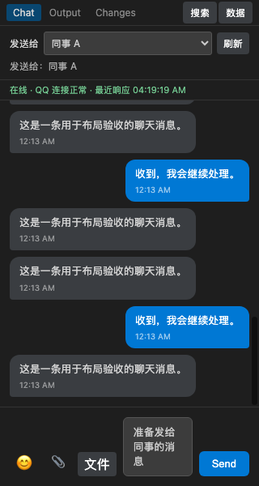
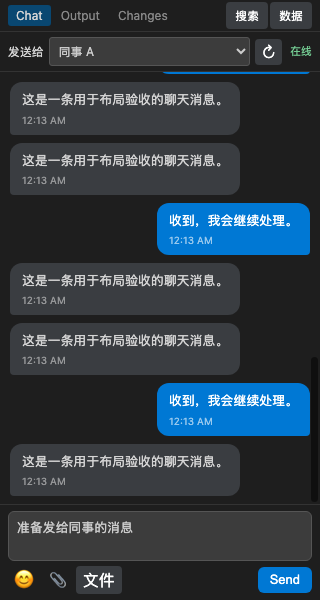

# 窄侧栏界面优化

2026-11-13，针对“界面拥挤，聊天或输入区域太小”的反馈更新。

- 输入框独占完整宽度，默认两行；附件和发送按钮移到下方紧凑工具条，内容增长与窗口调整会重新计算高度。
- 收件人始终可见，正常可发送时移除重复的“发送给”说明。在线状态与联系人同排，仅显示“在线”；完整详情保留在悬浮提示和无障碍标签中。错误、切换、只读、额度过期等说明不隐藏。
- 搜索和数据工具使用聊天区域内的独立工具层，不再同时挤压消息列表和输入栏。原消息 DOM 保留，但暂时不参与键盘和读屏访问；关闭或 Escape 返回输入框，保留阅读锚点、草稿与未读。恢复依然要求预览后明确确认。

## 实测尺寸

使用真实 HTML/CSS/JS、模拟联系人和聊天数据；没有连接通道或发送消息。结果为本机 Chromium 单次布局样本，不保证所有主题、字体或缩放完全相同。

| 尺寸及项目 | 修改前 | 修改后 |
|---|---:|---:|
| 320×600：输入框宽度 | 85.9 px | 304 px |
| 320×600：顶部占用 | 124.3 px | 72 px |
| 320×600：常态聊天区高度 | 377.7 px | 432 px |
| 320×600：四行草稿时聊天区高度 | 290.7 px | 395 px |
| 420×850：输入框宽度 | 185.9 px | 404 px |
| 420×850：常态聊天区高度 | 663.7 px | 682 px |
| 420×850：四行草稿时聊天区高度 | 609.7 px | 645 px |

修改前 320×600 数据面板会将聊天区压到 24 px，并把输入区域挤出窗口；现在工具面板在聊天区内滚动，输入框位置及聊天布局尺寸保持不变。两尺寸的常态、四行草稿、搜索、数据共 8 个场景均无横向或纵向页面溢出。

320 像素宽对照：

| 修改前 | 修改后 |
|---|---|
|  |  |

[数据面板截图](ui-review/data-320.png)

## 验证与安装

- 全量 `npm test`：**482／482 通过**，无跳过或取消；日志 `/tmp/vschat-ui-review-tests.log`。
- `npm run build`（含类型检查）通过；日志 `/tmp/vschat-ui-review-build.log`。
- 两尺寸 **30／30** 浏览器检查通过：22 项工具层互斥、Escape、保留 DOM／锚点／草稿／未读、遮盖内容的键盘隔离、断线及额度不足说明、无自动发送／已读，加 8 项窗口宽高变化后的输入高度调整。测量与断言保留在 `/tmp/vschat-layout-after.json`。
- `git diff --check`、VSCE 打包及 ZIP CRC 校验通过；包内 9 项运行文件与工作区相符（README 仅有预期的相对链接改写），WASM 有效，共 11 个包条目；原 review 包哈希保持不变。
- 真实 VS Code 主题、原生操作和平台收发仍需人工验收；本轮没有安装激活、发送真实消息、提交或发布。

本批仅改善界面空间。上一批功能完成范围和剩余事项仍见 [交付核对](handoff-review.md)。原 review 包保留，更新包使用不同文件名；扩展内部仍为 0.9.5，应在原先的隔离验收环境中替换安装，再重载窗口。

更新包：[`vschat-0.9.5-ui-review.vsix`](../dist/vschat-0.9.5-ui-review.vsix)，1,379,444 字节。SHA-256：

```text
95d0e524b90c868dc154230bbb6297f0c062163c4ebf29992e7fc02f8c9e7bc5
```

```sh
code --user-data-dir /tmp/vschat-review-user --extensions-dir /tmp/vschat-review-extensions --install-extension /Users/midas/VsChat/dist/vschat-0.9.5-ui-review.vsix --force
```

安装后在隔离窗口执行 `Developer: Reload Window`。先用窄侧栏检查输入框、切换联系人、打开／关闭搜索与数据面板，再确认真实主题下是否仍有遮挡。

## 后续反馈修正

- 合并图片与普通文件入口：底部只有一个附件菜单，展开后选择图片或文件，原有两种传输能力保留。
- 收件人选择移至底部紧凑菜单；摘要显示当前对象，切换完成后收起，不再占用顶部整行。发送目标与账号校验保持不变。
- Changes 文字默认单行，长内容在消息行内横向滚动查看，不截断保存的正文。
- Output 与 Changes 增加引用按钮、待发送引用预览、取消引用及已有引用跳转；导入历史和无服务器消息 ID 的记录仍不可引用发送。
- 新增两个视图引用发送的协议回归，隔离浏览器 11 项交互检查通过。更新包为 `dist/vschat-0.9.5-ui2-review.vsix`。

## 简洁界面与拖拽修复

- 在线状态移至底部工具条，点击或悬浮查看详情，不再占用顶部整行。
- 三种视图的引用按钮默认隐藏，鼠标悬浮消息或键盘聚焦时显示；触摸设备保持可操作。
- 补齐文件 dragover/drop 处理，一次拖入一张 PNG/JPEG/GIF/WebP/BMP 图片生成草稿（10 MB 上限），不会自动发送；拖入时显示输入区域边框提示。普通文件仍从附件菜单选择。工具面板打开、发送中或未选择联系人时不会替换图片草稿，迟到读取不能串到另一联系人。
- “已发送”和手动确认成功不再占据状态行，悬浮发送按钮可查看；失败、未知结果和警告继续明确显示。
- 收件人菜单可保存或清除本地备注，按通道与账号/联系人标识区分。备注保存在当前窗口的 Webview 状态中，重建面板可恢复，不承诺跨窗口同步；原始联系人标识仍保留在菜单和提示中，不改变实际发送对象。
- 附件、收件人和连接详情菜单支持点击外部或 Escape 关闭。
- 新增五项交互回归；窄侧栏模拟浏览器15项检查通过。真实 VS Code 的外部拖拽来源仍需用户实测。

## 2026-11-14：发送反馈、Output 同行与统一附件

本轮在 `feat/chat-reliability-ui-20261113` 上修改，开始时工作区干净；未开启并发写入、未提交或推送。

- 发送：前端原本已直接提交请求，没有草稿等待计时器；QQ 路径仍需等待目标/回复序号校验、HTTP 响应和本地记录落盘。原来的发送中长提示会撑开额外一行，现改为固定宽度发送按钮内的“发送中…”。仍在确认成功后清理草稿，失败/不确定结果仍可恢复。未发送真实消息，因此不声称网络耗时降低。
- Output：multipart 文本的外层 div 导致时间和正文分行，现将该外层改为行内。时间与正文首行同排，长行可横向滚动，保留正文中的显式换行。Changes 保持同行。图片和文件卡片仍可独立占行。
- 拖拽：在捕获阶段拦截拖拽，兼容 DataTransfer.items 和缺失 MIME 的常见图片，并处理 Chromium 将拖拽类型转为小写的情况；图片/文件均只进入待发送区，不自动发送。仅提供 URI 的编辑器拖拽明确提示无法取得内容，不按任意宿主路径读取文件。
- 附件：一个回形针、一个本机文件选择框，自动区分图片和普通文件。普通文件以限长字节传入宿主并生成联系人绑定的私有草稿，不再让图片与文件使用不同来源的对话框。图片上限 10 MiB、普通文件上限 20 MiB（同时服从通道能力）；目前每次一个附件。远程宿主文件不再由该入口直接浏览，旧的宿主选择处理仍为兼容保留。
- 样式：统一附件、移除按钮和收件人菜单控件的主题色、间距、圆角及键盘焦点；附件说明缩短，快捷键说明放入悬浮提示；检查了窄窗口菜单和横向溢出。

验证：493 项 Node 测试通过，类型检查和构建通过；本地 Chromium 320×600 隔离夹具 27 项通过，包括三模式引用、multipart 同行、图片 MIME 缺失、普通文件暂存、URI-only 提示、联系人菜单边界和发送反馈。已查看实际截图。浏览器使用模拟数据和合成拖拽，不能代替 Finder/Windows 资源管理器到真实 VS Code/Remote SSH Webview 的端到端验收。

产物：`dist/vschat-0.9.5-ui4-review.vsix`。本轮仅打包，尚未安装到正在运行的 VS Code；没有改动凭据或聊天数据，没有发送真实消息或发布。

建议验收：安装后重新加载窗口，在 Output 查看一条普通文本及一条 multipart 记录；从 Finder/资源管理器拖一张 PNG 到输入框，检查预览（无需点击发送）；点击回形针分别选择图片和 txt；在 Remote SSH 中重复，并区分系统文件与编辑器资源路径。真实发送耗时需用户自行发送测试消息，结合诊断日志中的 QQ 请求耗时判断。

### ui4 安装与真实窗口验收补记（2026-11-14）

用户随后明确同意安装、重载及附件验收。已使用当前运行的 VS Code Server（Stable-69047191fc427f2f92828279aae1d90d8eeda7ab）的 CLI 安装 ui4 到 `~/.vscode-server/extensions/panicmaker.vschat-0.9.5/`，安装报告成功，extension.js、main.js、styles.css、WASM 与 VSIX 逐字节一致。

Mac 解锁后，确认实际窗口为 `README.md — VsChat [SSH: Mac]`，执行 Developer: Reload Window。重载后回形针变为“添加图片或文件”单一按钮，确认新版实际加载。在这个真实 Remote SSH 窗口中：

- 同一个本机原生选择框选择隔离的 preview-test.png，出现“待发送图片”和文件名。
- 移除测试图片后，使用同一入口选择 attachment-test.txt，出现“51 B”和待发送文件卡片；随后移除测试附件。
- 切到 Output，截图确认实际文本消息时间与正文同排。
- 两次 Finder 跨窗口拖拽操作没有观察到图片预览。自动化跨窗口坐标/落点与 VS Code 拖拽事件链尚未区分，真实拖拽验收未通过，不能以浏览器合成测试代替。

未点击发送、未读取凭据、未编辑或删除历史消息；没有测试真实 QQ 发送耗时。Windows 客户端未操作。测试文件位于 `/tmp/vschat-ui-acceptance/`，不含用户数据。

### ui5：Finder 手动拖拽失败后的事件链修复

用户报告 ui4 手动拖拽同样无预览，因此不再把失败归因于自动化落点。检查当前客户端随附的 VS Code Webview preload（`out/vs/workbench/contrib/webview/browser/pre/index.html`）发现：`handleInnerDragStartEvent` 在 dragenter 未被取消时通知宿主 `drag-start`；`handleInnerDragEvent` 还会继续转发 drag。ui4 只处理 dragover/drop，没有声明 dragenter 的归属。

ui5 在捕获阶段统一接管 dragenter 和 dragover，对文件拖拽 preventDefault 并 stopImmediatePropagation；drop 同样阻止宿主同目标监听器继续处理。保留缺失 MIME、items 文件提取、联系人绑定与 URI-only 拒绝规则，不读取任意远程路径。

494 项 Node 回归通过；30 项浏览器检查通过，其中新增模拟 VS Code 的宿主 dragenter/dragover 监听器，确认不会触发编辑器拖放层、不会继续转发 drag，并能经完整事件序列暂存图片。该检查仍是隔离复现，不等同于真实 Finder 验收。

已安装 `dist/vschat-0.9.5-ui5-review.vsix` 到同一 Mac Remote SSH 扩展环境，运行文件与包一致，SHA256 为 `51aee860e4cf325170e7196e75190f0ff050af2c0c1e547cd4f3220e536cfa7f`。已执行当前 SSH: Mac 窗口重载并确认重新连接。正在等待用户手动复验是否出现虚线边框及预览；未发送消息、未读取凭据。

ui5 真实验收结果：用户手动从 Finder 拖图后确认“已出现待发送预览”；随后通过当前 SSH: Mac 窗口的辅助功能树再次观察到“待发送图片”、用户图片文件名及“移除粘贴的图片”按钮。至此，Mac 客户端 → Remote SSH Mac 的 Finder 图片拖拽预览通过真实验收；未点击发送，也未移除用户刚拖入的附件。Windows 客户端及真实图片发送仍未测试。

### ui6：图片单独发送的快捷键和受限状态

用户反馈预览成功但回车不能发送。只读检查真实窗口确认：快捷键为 Enter，当前所选 QQ 联系人显示“暂无可用被动回复额度”，发送按钮 disabled；图片不要求附带文字。没有点击发送或读取凭据。

代码审查发现选图/拖图后未主动恢复输入框焦点，ui6 补上图片或文件暂存时的 focus；有待发送内容但联系人不可发送时，直接显示该联系人的受限原因，并让禁用按钮的悬浮提示保持一致。仍遵守 Enter / Ctrl或Cmd+Enter 配置、输入法保护、防重复发送和未知结果恢复，不绕过 QQ 额度。

496 项自动测试通过（新增图片-only 的 Enter/Cmd+Enter、焦点、无文字发送，以及额度失效时按钮/快捷键均不得提交且保留草稿的检查），30 项隔离浏览器检查和构建通过。ui6 已安装到 Mac 的 Remote SSH 扩展目录，四项运行文件与包逐字节一致；此次未重载或修改用户现有待发送图片，需用户准备好后重新加载窗口使 ui6 生效。真实图片发送与网络耗时未验收，需当前联系人先给机器人发新消息以刷新回复上下文，再由用户自己确认发送。

### ui7：图片上传失败被误标为“待确认”

只读检查当前远程 VsChat 诊断日志（不读取凭据或消息正文）发现 07:32:42 和 07:33:01 UTC 附近的两次图片尝试：预上传成功，随后单个分片各重试三次均报 network failure，最终堆栈位于 putUploadPart → uploadMedia → sendImage。未到达最终 /messages 调用；上传/合并流程使用 srv_send_msg=false。这些尝试属于上传失败，并非聊天消息请求结果未知。

缺陷：provider 在进入 sendImage 后便将普通 Error 视为 uncertain；普通文件已有发送边界分类，图片没有。ui7 为图片增加相同边界：图片读取、上传、合并、回复上下文准备失败为 not_sent，最终发送超时、缺少 ID 或发送后落盘失败仍保守为 uncertain。QQ 最终接口明确的 4xx 拒绝（408 除外）及成功 HTTP 响应中的业务拒绝也归类为未发送；5xx、408 和传输异常不据此断言未发送。不会自动重试最终消息。

图片上传准备、分片、确认、合并和最终请求增加 30 秒单请求上限。分片网络失败日志仅增加受限格式的错误码、固定错误类型及已知固定失败类别，不记录签名地址、凭据或消息正文。旧日志没有保存底层异常原因，尚不能确定是代理、连接、TLS、端口还是其他网络/请求问题，不能宣称实际上传问题已经解决。

506 项自动测试通过，覆盖各图片准备阶段不得调用最终消息接口、最终超时/缺失 ID 保持不确定、明确拒绝与模糊失败分类、provider 回执以及日志敏感内容不泄漏。没有重发用户图片或修改现有草稿、聊天记录与旧请求状态。

ui7 已安装到当前 Mac Remote SSH 扩展目录，四项运行文件与 VSIX 校验一致。未重载，避免介入用户当前待确认草稿；新分类和更详细的网络诊断需重载后生效，旧尝试的 UI 状态不会被凭空改为成功或自动重发。

## ui8: upload invalid-argument diagnostics

User reported `UND_ERR_INVALID_ARG` on QQ media PUT. A loopback HTTP server with real undici 6.26.0 accepted the existing Buffer/Content-Length request (200); isolated ProxyAgent dispatch through real Request validation also accepted it. This does not establish the user's root cause; no speculative header/proxy change was made. Added fixed allowlisted cause labels (including duplicate/invalid content length and proxy authentication) without logging arbitrary error messages, signed URLs, or payloads. Invalid arguments now stop retries immediately and ask for the diagnostic code rather than blaming network connectivity. Draft retention is unchanged.

Validation: 507 tests passed, build/typecheck and diff checks passed. No real QQ calls, credentials, or user media used. ui8 is a diagnostic build, not a verified image-upload fix; real user retry is still needed after reload.

## ui9: QQ image upload repaired and verified in Remote SSH

ui8's live safe diagnostic identified `UND_ERR_INVALID_ARG / invalid_content_length` before any final message submission. Removed the manually supplied Content-Length from media PUT; undici now derives the header from the Buffer. Added a dispatcher-level regression asserting one lowercase byte-accurate length header. 508 tests passed; VSIX prepublish build/typecheck passed; installed bundle verified byte-identical to ui9 on Mac Remote SSH, then window reloaded.

With explicit user authorization, retried the existing pending PNG once to the unchanged selected recipient. Prior attempt logs showed failure at upload, before message submission. At 2026-11-14 08:00:06 UTC, QQ logged image accepted with a message ID; total duration 3628ms. UI showed 已发送 and removed the pending preview. No other messages sent, no credentials read, no push/publication. Recipient-side viewing is not verified. The exact host integration mechanism making the explicit length invalid remains unproven, but removing that header resolved the real failure.

Separate observed issue: after reload, a previously definitive failed draft appeared uncertain. Left its persisted state untouched; this should receive a separate recovery-state regression and fix.

## Main-branch delivery review (2026-11-14)

User confirmed receipt of the ui9 image, completing end-to-end Mac Remote SSH verification. Re-ran 508 tests successfully and the build/typecheck before integration. Version advanced to 0.9.6 because main-branch CI automatically publishes releases; this keeps the existing 0.9.5 release intact. Windows-client drag/drop and recipient-side behavior outside the validated QQ image flow remain outside this manual acceptance. The conservative failed-to-uncertain state after window reload remains a known limitation; it never automatically retries.
